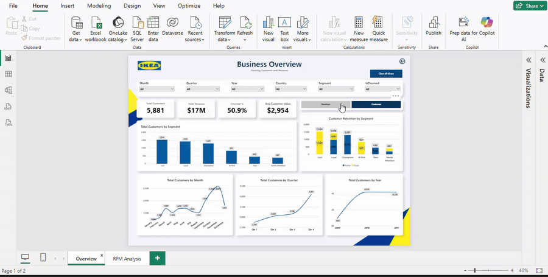

# IKEA Gifting: Customer Analytics and RFM Segmentation

*An End-to-End Data Analytics Project Using SQL, Python, and Power BI*

---

## Project Demo

Watch the animated demonstration of the IKEA Gifting Power BI dashboard:



---

## Disclaimer

**IKEA Gifting** is a fictional company name created for this educational portfolio project. It is not affiliated with, endorsed by, or representative of the real IKEA corporation in any way.All financial figures, customer counts, and business metrics shown in this project are derived entirely from a public, anonymized transactional dataset and do not reflect any real company's actual performance. The IKEA visual branding used in the dashboard is for design and storytelling purposes only.

---

## Project Overview

This project simulates a real-world analytics engagement for a fictional UK-based gifting and home decor e-commerce brand, **IKEA Gifting**.
The goal was to take raw, messy transactional data all the way through to a decision-ready business intelligence dashboard, using the same workflow a data analyst would follow inside a real company:

- Define the business problem first.
- Clean and validate the data in SQL.
- Build the analytical logic in Python.
- Deliver actionable insights through an interactive Power BI report.

Built as part of a public tutorial series to teach **SQL, Python, and Power BI together as one connected skillset**, rather than as three isolated topics.

---

## My Thinking Process

Most portfolio projects start with a dataset and work backward to a question. I reversed that.
I started by writing a **Business Requirements Document (BRD)** before touching any data, forcing myself to define exactly what business decision this analysis needed to support.
Every technical step after that traces back to the questions in that document.
I also deliberately chose a dataset that's less commonly used in existing tutorials (Online Retail II instead of the more saturated Olist dataset), and chose to genuinely clean the data rather than use a pre-cleaned version.

This project includes real data quality problems:

- Mixed date formats
- Invalid row types
- Duplicate transactions
- Missing customer identifiers

Solving these problems is a major part of what this project demonstrates.

---

## Business Problem

The business wants to identify its most valuable customers and reduce churn among customers who are at risk of leaving.
Leadership currently has no structured view of customer value, so retention efforts are reactive instead of targeted.

### Business Questions Answered

- Who are our most valuable customers, and how much revenue do they actually contribute?
- Which customers have gone quiet and are at risk of churning?
- How does customer value and retention trend across time, by month, quarter, and year?
- How does customer value and churn differ across geographic markets?
- What specific, concrete actions should the business take for each customer segment?

---

## Key Findings

- **Champions** represent roughly 22% of the customer base but generate close to **68% of total revenue** — a clear 80/20 concentration.
- Overall churn sits at **50.86%** (90-day inactivity threshold), indicating retention is a significant business risk.
- Average customer value varies sharply by segment, from a few hundred for Lost customers to several thousand for Champions.
- Revenue shows clear seasonal spikes in Q4, consistent with a gifting-focused product category.

---

## Data Source

**Online Retail II**, UCI Machine Learning Repository, donated by Daqing Chen.

- Dataset: Online Retail II
- Business: UK-based, non-store online retailer selling all-occasion giftware
- Period: December 2009 to December 2011
- Raw records: 1,067,371 transaction rows across two sheets
- License: Creative Commons Attribution 4.0 International (CC BY 4.0)

---

## Tools and Tech Stack

| Tool | Purpose in This Project |
|---|---|
| SQL Server / SSMS | Data import, cleaning, deduplication, and exploratory querying on the full 1M+ row dataset |
| Python (Pandas) | RFM calculation, customer scoring, segmentation logic, and churn flagging |
| Jupyter Notebook | Interactive development environment for Python analysis |
| Power BI Desktop | Three-page interactive dashboard: executive summary and RFM deep dive |
| DAX | Measures for customer counts, revenue totals, and average customer value |

---

## Core Concepts Demonstrated

- **RFM Analysis:** Scoring customers on Recency, Frequency, and Monetary value to quantify customer worth on a comparable scale.
- **Customer Segmentation:** Translating raw RFM scores into business-meaningful groups (Champions, Loyal, At Risk, New, Needs Attention, Lost).
- **Churn Definition and Flagging:** Applying a fixed inactivity threshold to identify customers at risk of lapsing.
- **Data Quality Handling:** Resolving mixed date formats, invalid type conversions, and duplicate detection using SQL window functions.
- **Dimensional Modeling for BI:** Structuring a single unified table so multiple report pages can share one clean source without manual relationships.
- **Interactive BI Design:** Slicers, bookmark-based toggles, and a multi-page navigation structure inside Power BI.

---

## Project Workflow

### Step 1 — Business Requirements Document

Defined project scope, business questions, key definitions, and success criteria before any data work began.

### Step 2 — SQL: Data Cleaning and Exploration

- Imported both raw sheets into SQL Server.
- Corrected data types.
- Resolved a mixed date format issue affecting over half the dataset.
- Removed 32,907 exact duplicate rows.
- Validated row counts at every step against the published UCI total.

### Step 3 — Python: RFM Segmentation

- Loaded the cleaned data into Pandas.
- Calculated Recency, Frequency, and Monetary value per customer.
- Scored each customer on a 1-to-5 scale per dimension.
- Assigned each of the 5,881 customers to one of six segments.
- Added a 90-day churn flag.

### Step 4 — Power BI: Dashboard Development

Merged the segmentation results back onto transaction-level data to create a single analysis-ready table, then built a three-page interactive report.

---

## Dashboard Structure

### Page 1 — Home

- Project title and introduction.
- Navigation to the two report pages.
- Glossary defining Recency, Frequency, Monetary, and Churned %.

### Page 2 — Business Overview

**Headline KPIs:**

- Total Customers
- Total Revenue
- Churn %
- Average Customer Value

**Visualizations and features:**

- Revenue / Customer toggle.
- Customer segment breakdowns.
- Month, quarter, and year trend views.
- Interactive filtering by month, quarter, year, country, segment, and churn status.

### Page 3 — RFM Analysis

**Visualizations and features:**

- Segment Performance Summary table.
- Customer count by segment.
- Total revenue by segment.
- Average R Score, F Score, and M Score.
- Average Customer Value by segment.
- Churn percentage trends over time.

---

## Sample SQL: Handling Mixed Date Formats

The following SQL query handles mixed date formats using `TRY_CONVERT` and `COALESCE`.

```sql
SELECT
    Invoice,
    StockCode,
    Description,
    Quantity,
    COALESCE(
        TRY_CONVERT(datetime2, InvoiceDate, 120),
        TRY_CONVERT(datetime2, InvoiceDate, 105)
    ) AS InvoiceDate,
    TRY_CONVERT(decimal(10,2), Price) AS Price,
    Customer_ID,
    Country
INTO dbo.RetailCombined
FROM dbo.[Year 2009-2010];
```

---

## Sample Python: RFM Scoring

The following code calculates Recency, Frequency, and Monetary scores using Pandas `qcut()`.

```python
rfm['R_Score'] = pd.qcut(
    rfm['Recency'],
    5,
    labels=[5, 4, 3, 2, 1]
).astype(int)

rfm['F_Score'] = pd.qcut(
    rfm['Frequency'].rank(method='first'),
    5,
    labels=[1, 2, 3, 4, 5]
).astype(int)

rfm['M_Score'] = pd.qcut(
    rfm['Monetary'],
    5,
    labels=[1, 2, 3, 4, 5]
).astype(int)
```

---

## How to Reproduce This Project

Follow these steps to recreate the complete project:

1. Download the Online Retail II dataset from the UCI Machine Learning Repository.
2. Run the SQL scripts in `01_sql` in order to recreate the cleaned `RetailCleaned` table.
3. Export `RetailCleaned` to CSV and run the notebook in `02_python` to generate the segmented dataset.
4. Open the Power BI file in `03_powerbi` and point it to the exported Excel file to refresh.

---

## Project Objectives

This project demonstrates an end-to-end data analytics workflow, including:

- Business understanding and requirement gathering.
- SQL-based data cleaning and validation.
- Python-based customer analytics.
- RFM segmentation and churn analysis.
- Power BI dashboard development.
- Interactive data visualization and business storytelling.

The ultimate objective is to transform raw transactional data into meaningful business insights that support better customer retention and revenue growth decisions.

---

## Repository Structure

```text
IKEA-Gifting-Analytics/
│
├── README.md
├── SHOW.gif
│
├── 01_sql/
│   └── SQL Scripts
│
├── 02_python/
│   └── RFM Analysis Notebook
│
└── 03_powerbi/
    └── Power BI Dashboard
```

---

## Project Note

This project is part of my learning journey in Data Analytics, focusing on practical applications of SQL, Python, and Power BI.
Thank you for visiting this repository!
